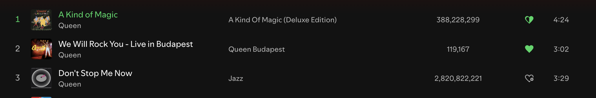
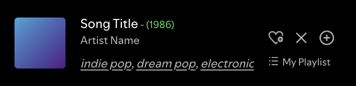
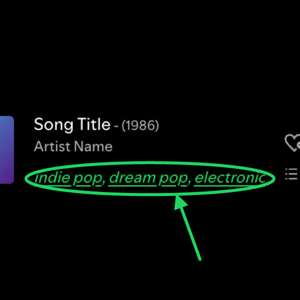
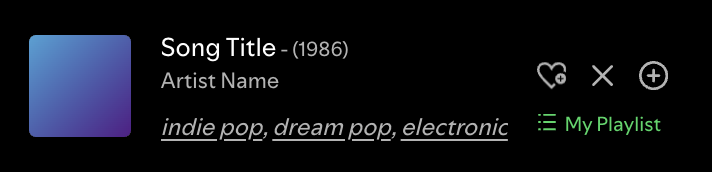
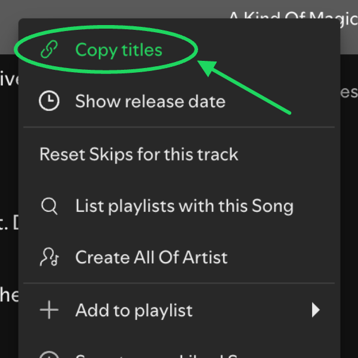
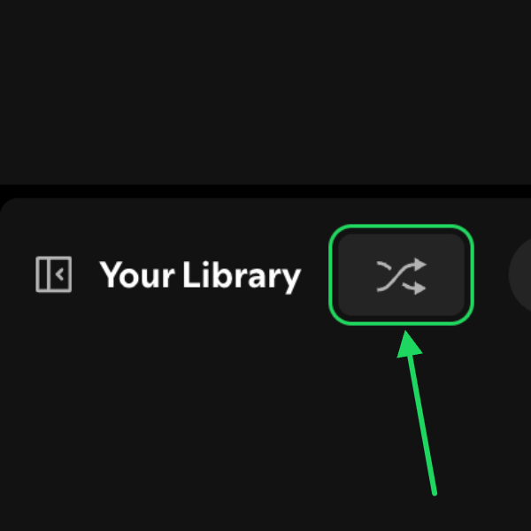
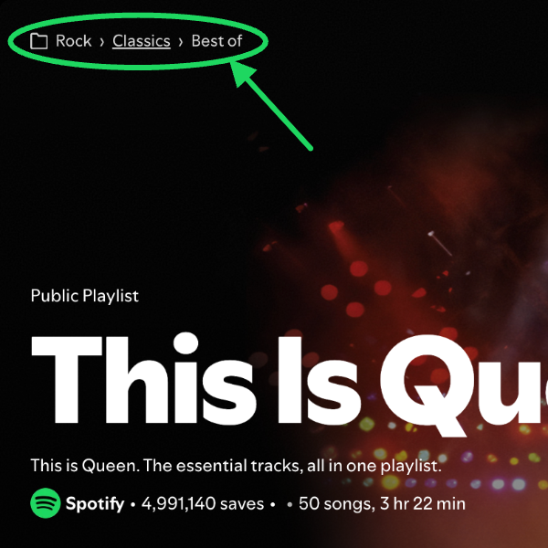
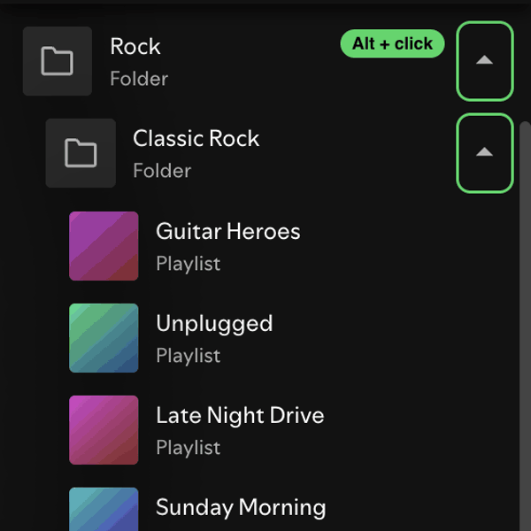
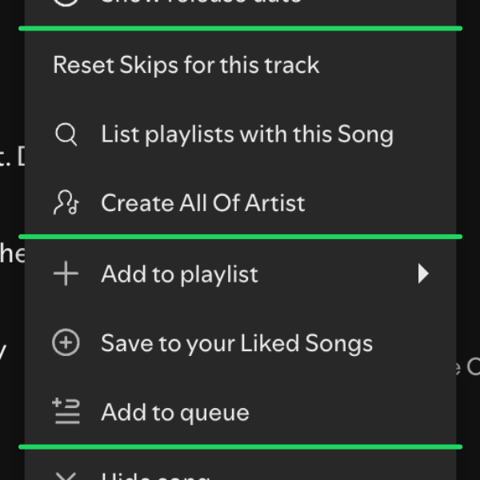

# w-spicetify-extensions

Extensions for [Spicetify](https://spicetify.app). They only use Spotify's internal client APIs, not the public Web API, so they do not run into its rate limits (429).

Built and tested on Spotify 1.2.87 with spicetify 2.46.4.

| | Extension | What it does |
|---|---|---|
|  | [Like Button](like-button/) | Heart button on track rows. Half heart: another version is liked. |
|  | [Release Date](release-date/) | Release year next to the playing track's title. |
|  | [Genre Tags](genre-tags/) | Genres in the now playing bar, linked to 'The Sound of' playlists. |
|  | [Playing From](playing-from/) | Shows the playlist or album you are playing from. Click to open it. |
|  | [Copy Track Titles](copy-track-titles/) | Right-click tracks to copy them as 'Artist - Title'. |
|  | [Random Playlist](random-playlist/) | Button that plays a random playlist from your library. |
|  | [Folder Breadcrumb](folder-breadcrumb/) | Folder path at the top of a playlist. Click to jump to the folder. |
|  | [Folder Alt Click](folder-alt-click/) | Alt-click a folder arrow to collapse or expand all its subfolders. |
|  | [Menu Dividers](menu-dividers/) | Extra dividers that group the track right-click menu. |
| | [Made For You](made-for-you/) | Custom app: a "Made For You" link in the navigation that opens Spotify's own Made For You page. |

## Install

**Marketplace:** search for the extension name in the Extensions tab of the Spicetify Marketplace.

**Manual:** copy the `.js` file of an extension into your spicetify `Extensions` folder (`spicetify config-dir` shows where), then:

```sh
spicetify config extensions like-button.js
spicetify apply
```

Made For You is a custom app, see [its README](made-for-you/README.md).

## Notes

- Genre Tags needs a free [Last.fm API key](https://www.last.fm/api/account/create), see [its README](genre-tags/README.md).
- Menu Dividers, Random Playlist and Folder Alt Click match on Spotify's English labels, so they need the client language set to English.
- Spotify changes its client often. If something breaks after a Spotify update, open an issue.

## License

MIT
