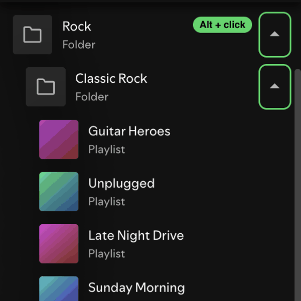

# Folder Alt Click

Alt-click the arrow of a folder in Your Library:

- on an open folder: closes it and every subfolder inside it, so it opens clean next time
- on a closed folder: opens it and every subfolder inside it

Uses `RootlistAPI.getContents()` for the folder tree and the native `ylx-expanded-folders` setting.
