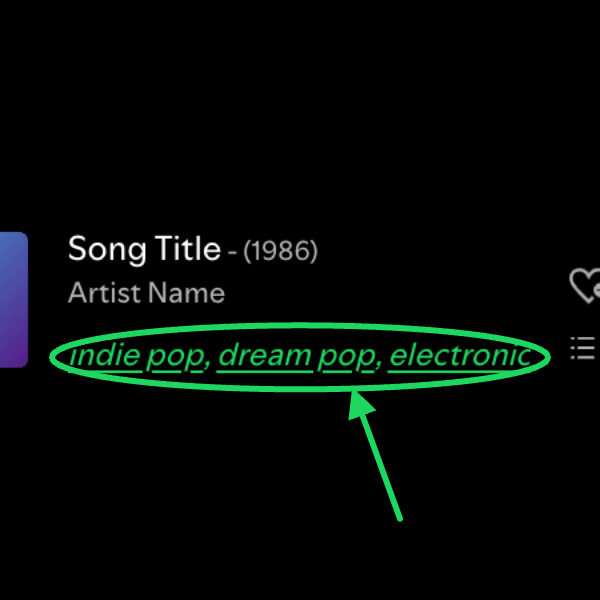

# Genre Tags

Shows the genres of the playing artist in the now playing bar, and links each one to its "The Sound of ..." playlist from [The Sounds of Spotify](https://open.spotify.com/user/thesoundsofspotify) (the Every Noise at Once playlists, like [The Sound of Everything](https://open.spotify.com/playlist/69fEt9DN5r4JQATi52sRtq)).

- The genres are the artist's top tags on Last.fm, shown under the artist name.
- Click a genre to open the matching "The Sound of ..." playlist, for example "The Sound of Dream Pop".
- If there is no exact match it opens the playlist search instead, where playlists by The Sounds of Spotify get a green border.

Spotify no longer exposes artist genres in its client, and the Web API is rate limited, so the tags come from Last.fm.

## Setup

You need a free [Last.fm API key](https://www.last.fm/api/account/create).

Open your profile menu (top right) and choose **Genre Tags: Last.fm key**, paste the key and save. It is checked against Last.fm before it is stored. Until a key is set, the now playing bar shows a "Set Last.fm key to show genres" link that opens the same dialog.

If you use the Stats custom app with a Last.fm key, that key is used automatically.

## How the playlist lookup works

On first start it fetches the list of all "The Sound of" playlists once in the background (about 7000, takes under a minute) and caches it in localStorage for 30 days. Tag clicks before that finishes go to the search page.
