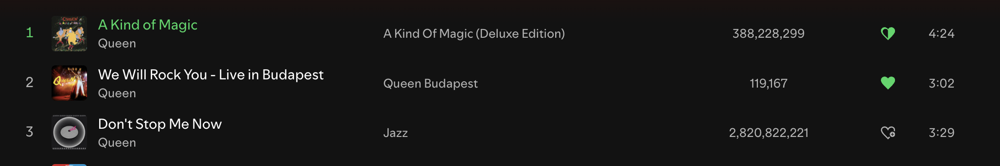

# Like Button

Heart button on tracklist rows and in the now playing bar, next to Spotify's own add button.

- Full heart: liked.
- Half heart: another version of the same recording (same ISRC) is already liked.
- Heart with a plus: not liked.

Inspired by Old Like Button by Maskowh. This one uses no Web API:

- The liked list and like/unlike go through `Spicetify.Platform.LibraryAPI`.
- ISRCs come from the client's internal metadata service, one at a time with a pause, backing off 60 s on errors.
- ISRCs are cached in IndexedDB `like-button`. On first run it imports the cache of Old Like Button (`maskowh-oldlike-*` in localStorage) if present.
