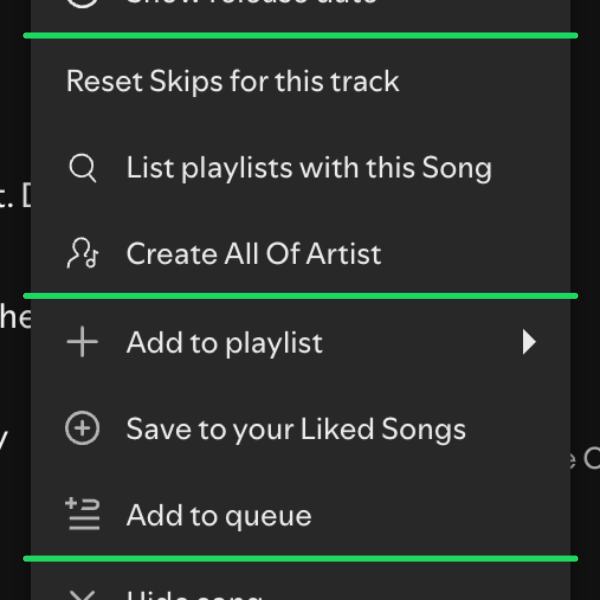

# Menu Dividers

Groups the track context menu with extra dividers:

1. the items of the extensions in this repo (Copy titles, Show release date)
2. items of other extensions
3. Spotify's own items, with an extra divider before "Hide song"

Wraps `Spicetify.ContextMenuV2.renderItems`. The item names are listed in `OWN` and `NATIVE_DIVIDE_BEFORE` at the top of the file and are matched on English labels.
