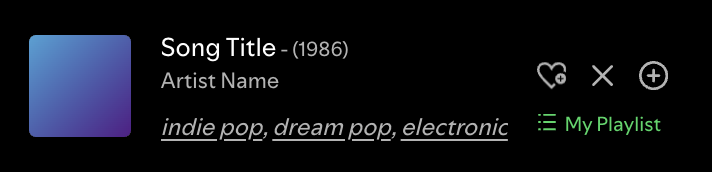

# Playing From

Shows what you are playing from in the now playing bar, under the like buttons: a playlist, album or artist, with a matching icon. Click it to open it.

During autoplay it shows "Recommended songs", and a click opens the queue.

It also hides the "Lossless" label under the artist and makes the now playing bar a little taller (84px) to fit the extra line.

Uses `Spicetify.Player.data.context`.
